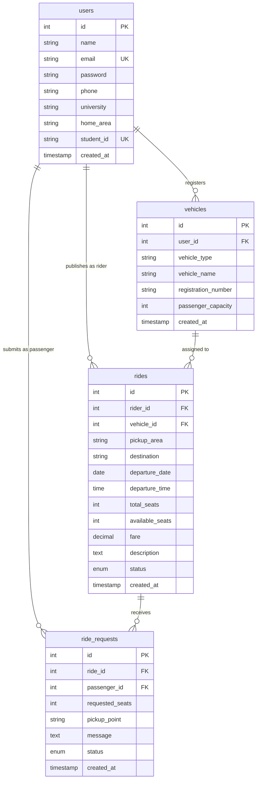
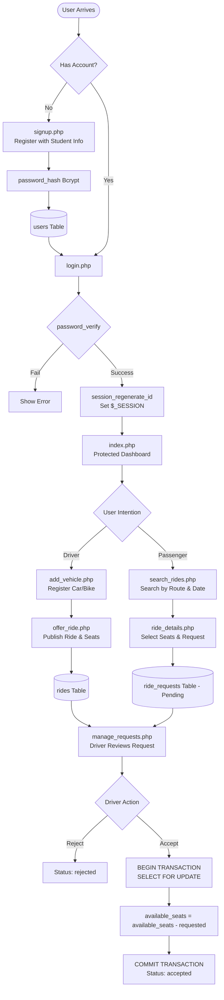

# CampusRide — Student Commute & Ride-Share Platform

> A secure, full-stack, peer-to-peer campus ridesharing web application engineered with native PHP, MySQL (InnoDB), Apache2, and vanilla frontend technologies for university commuters.

---

## Table of Contents
1. [Project Overview](#project-overview)
2. [Key Features](#key-features)
3. [System Architecture](#system-architecture)
4. [Database Design & Schema](#database-design--schema)
5. [End-to-End Application Workflows](#end-to-end-application-workflows)
6. [Security & Concurrency Control](#security--concurrency-control)
7. [Directory Structure](#directory-structure)
8. [Complete Setup & Installation Guide](#complete-setup--installation-guide)
   - [Linux / Ubuntu Environment (Production/Lab)](#1-linux--ubuntu-setup-apache2--php--mysql)
   - [Windows Environment (XAMPP / WAMP)](#2-windows-setup-xampp)
9. [Demonstration & Verification Script](#demonstration--verification-script)

---

## Project Overview

University students face daily commuting challenges: overcrowded public transit, volatile ride-hailing fares, and campus parking congestion. **CampusRide** provides a trusted, university-specific carpooling network where students who drive can list empty seats in their vehicles, and peers traveling the same route can book rides safely and affordably.

### Tech Stack
- **Operating Environment:** Linux (Ubuntu 22.04 / 24.04 LTS / WSL / Virtual Machine)
- **Web Server:** Apache HTTP Server (`apache2`)
- **Backend Language:** PHP 8.x (Native / Core PHP, Procedural + Object-Oriented MySQLi)
- **Database:** MySQL 8.x (InnoDB Storage Engine, Foreign Keys, ACID Transactions)
- **Frontend:** Vanilla HTML5, Responsive CSS3 (Flexbox & CSS Grid), ES6+ JavaScript

---

## Key Features

- **Strict Student Authentication:** Secure signup with validated university identification, unique email constraints, and one-way salted password hashing.
- **Session-Based Access Control:** Centralized authentication middleware safeguarding all private routes against unauthorized access.
- **Fleet & Vehicle Registration:** Drivers can register multiple vehicles (Bikes, Motorcycles, Cars) with passenger capacity constraints.
- **Intelligent Ride Publishing:** Drivers schedule departures with pickup/destination areas, departure timestamps, per-seat fares, and auto-validated seat capacities.
- **Ride Search & Discovery:** Passenger search engine filtering by pickup neighborhood, destination campus, and travel date.
- **Transactional Seat Booking Lifecycle:** Complete state machine (`pending` $\rightarrow$ `accepted` / `rejected` / `cancelled`) with database row-level locking (`FOR UPDATE`) to prevent overselling.
- **Dual Dashboards:** Separate management portals for drivers (*My Rides* / *Manage Requests*) and passengers (*My Requests*).

---

## System Architecture

CampusRide follows a decoupled multi-tier web architecture:

```
[ User Web Browser ]
         │ (HTTP / HTTPS Requests)
         ▼
[ Apache2 Web Server ]
         │ (VirtualHost & DocumentRoot Routing)
         ▼
[ PHP 8 Backend Engine ]
   ├── includes/auth.php     ── Session Validation & Access Guard
   ├── config/db.php         ── Resilient Database Connection Pool
   └── Application Scripts   ── Input Validation, Password Hashing, Business Logic
         │
         ├── MySQLi Prepared Statements (Param-Bound Binary Protocol)
         │
         ▼
[ MySQL Database Server (InnoDB) ]
   ├── users          (Student Profiles & Bcrypt Hashes)
   ├── vehicles       (Registered Vehicles & Seat Caps)
   ├── rides          (Scheduled Routes & Live Seat Counts)
   └── ride_requests  (Booking States & Transactional Locks)
```

### Component Responsibilities
| Layer | Technology | Primary Function |
| :--- | :--- | :--- |
| **Presentation** | HTML5, CSS3, JS | Responsive UI cards, interactive show/hide password, client-side validation |
| **Web Server** | Apache 2.4 | Listens on port 80/443, passes `.php` scripts to `mod_php` execution engine |
| **Application** | PHP 8.x | Authentication, state validation, authorization, session lifecycle |
| **Data Access** | MySQLi Extension | Prepared SQL statements, parameter binding, row-level transactions |
| **Persistence** | MySQL InnoDB | Relational integrity, foreign key cascading, unique constraints, check constraints |

---

## Database Design & Schema

The relational schema is configured in `database/campusride_db.sql` using the **InnoDB** storage engine to support referential integrity and transactional rollback.

### Entity Relationship Diagram



### Table Definitions & Constraints

1. **`users` Table:**
   - `id`: Auto-incrementing primary key.
   - `email` & `student_id`: Marked `UNIQUE` to prevent multi-accounting.
   - `password`: Stored as `VARCHAR(255)` to accommodate 60-character Bcrypt output and future Argon2 hashing algorithms.

2. **`vehicles` Table:**
   - `user_id`: Foreign key referencing `users(id)` with `ON DELETE CASCADE`.
   - `passenger_capacity`: Enforced with `CHECK (passenger_capacity > 0)`.

3. **`rides` Table:**
   - `rider_id`: Foreign key referencing `users(id)` with `ON DELETE CASCADE`.
   - `vehicle_id`: Foreign key referencing `vehicles(id)` with `ON DELETE RESTRICT`.
   - `total_seats` & `available_seats`: Enforced with `CHECK (total_seats > 0 AND available_seats >= 0 AND available_seats <= total_seats)`.
   - `fare`: Enforced with `CHECK (fare >= 0)`.
   - Composite Index: `idx_rides_search` on `(pickup_area, destination, departure_date, status, available_seats)` for optimized search query execution.

4. **`ride_requests` Table:**
   - `status`: Enum (`'pending'`, `'accepted'`, `'rejected'`, `'cancelled'`).
   - `requested_seats`: Enforced with `CHECK (requested_seats > 0)`.
   - Composite Index: `idx_requests_lookup` on `(ride_id, passenger_id, status)`.

---

## End-to-End Application Workflows



### Detailed Workflow Descriptions

#### 1. Registration & Authentication Workflow
1. User submits name, university email, student ID, phone, home area, and password in `signup.php`.
2. Frontend validation verifies format and password match; backend validates fields and checks for existing `email` or `student_id`.
3. Password is encrypted using `password_hash($password, PASSWORD_DEFAULT)` generating a secure 60-character bcrypt hash with random salt.
4. On `login.php`, submitted credentials query the database using prepared statements.
5. Password is verified using `password_verify($password, $user['password'])`.
6. Upon successful match, `session_regenerate_id(true)` invalidates the old session token to prevent session fixation, and stores `$_SESSION['user_id']` and `$_SESSION['name']`.

#### 2. Vehicle Registration Workflow
1. Drivers navigate to `add_vehicle.php`.
2. Vehicle type (`Bike`, `Motorcycle`, or `Car`), model name, official registration/plate number, and max passenger capacity are recorded.
3. Multiple vehicles can be linked to a single student profile.

#### 3. Ride Publishing Workflow
1. Driver visits `offer_ride.php`.
2. Driver selects one of their registered vehicles from a dropdown.
3. The system queries the vehicle's capacity and prevents the driver from listing more available seats than the vehicle physically supports.
4. Departure date cannot be backdated to the past (`departure_date >= CURRENT_DATE`).
5. Ride is saved with status `active` and initial `available_seats = total_seats`.

#### 4. Search and Seat Request Workflow
1. Commuters visit `search_rides.php` and filter by departure location, destination campus, and date.
2. Clicking a ride opens `ride_details.php`.
3. Self-booking protection ensures drivers cannot request seats on their own rides (`rider_id !== passenger_id`).
4. Duplicate check blocks submitting multiple active requests for the same ride.
5. The request is created with initial status `pending`.

#### 5. Concurrency-Safe Request Management
1. Driver opens `manage_requests.php` to review incoming passenger requests.
2. When the driver clicks **Accept**:
   - `mysqli_begin_transaction($conn)` initiates an atomic database transaction.
   - `SELECT ... FOR UPDATE` applies a pessimistic lock on the ride record.
   - The system checks if `requested_seats <= available_seats`.
   - If sufficient, `available_seats` is decremented and request status is updated to `accepted`.
   - `mysqli_commit($conn)` persists the change atomically.
   - If seats are insufficient, the transaction throws an exception and rolls back (`mysqli_rollback($conn)`), preventing double-booking race conditions.

---

## Security & Concurrency Control

| Threat / Vulnerability | CampusRide Protection Mechanism | Implementation File |
| :--- | :--- | :--- |
| **SQL Injection** | Parameterized queries using `mysqli_prepare` and `mysqli_stmt_bind_param` | All DB interaction files |
| **Password Theft** | Irreversible Bcrypt salting & hashing via `password_hash()` | `signup.php` |
| **Session Fixation** | Re-issuing session identifier on authentication via `session_regenerate_id(true)` | `login.php` |
| **Unauthorized Access** | Route protection middleware `includes/auth.php` redirecting to `login.php` | `includes/auth.php` |
| **Race Conditions / Overselling** | Pessimistic locking (`FOR UPDATE`) inside ACID transactions | `manage_requests.php` |
| **Cross-Site Scripting (XSS)** | Context-aware output escaping using `htmlspecialchars()` | Template & header views |
| **Self-Booking Exploit** | Constraint verification rejecting requests where `rider_id == passenger_id` | `ride_details.php` |

---

## Directory Structure

```
CampusRide/
├── index.php                 # Protected homepage and main commute portal
├── login.php                 # User authentication and session instantiation
├── signup.php                # Student onboarding and validation
├── logout.php                # Session clearing and cookie termination
├── add_vehicle.php           # Vehicle registration and capacity management
├── offer_ride.php            # Ride publishing and route scheduling
├── search_rides.php          # Ride search and filtering engine
├── ride_details.php          # Detailed route view and seat booking submission
├── manage_requests.php       # Driver dashboard to accept/reject seat requests
├── my_rides.php              # Driver view of all published rides
├── my_requests.php           # Passenger dashboard to track/cancel requests
├── config/
│   └── db.php                # Database connection with resilient credentials fallback
├── includes/
│   ├── auth.php              # Authentication middleware and session guard
│   ├── header.php            # Shared responsive navigation and header layout
│   └── footer.php            # Shared closing tags and footer scripts
├── assets/
│   ├── css/
│   │   └── style.css         # Custom responsive stylesheet (No heavy frameworks)
│   └── js/
│       └── script.js         # Client-side input validation and password visibility toggle
├── database/
│   └── campusride_db.sql     # Complete DDL schema, tables, keys, and indexes
└── README.md                 # Complete system documentation
```

---

## Complete Setup & Installation Guide

### 1. Linux / Ubuntu Setup (Apache2 + PHP + MySQL)

Follow these steps in your Linux terminal (Ubuntu 20.04/22.04/24.04 or WSL):

#### Step 1: Update System Packages
```bash
sudo apt update && sudo apt upgrade -y
```

#### Step 2: Install Apache2, PHP, and Required Modules
```bash
sudo apt install apache2 php libapache2-mod-php php-mysql php-cli php-mbstring php-xml php-curl git -y
sudo systemctl enable apache2
sudo systemctl start apache2
```

#### Step 3: Install & Start MySQL Server
```bash
sudo apt install mysql-server -y
sudo systemctl enable mysql
sudo systemctl start mysql
```

#### Step 4: Configure the Database and User
Log in to MySQL as root:
```bash
sudo mysql
```
Execute the following SQL commands:
```sql
CREATE DATABASE IF NOT EXISTS campusride_db CHARACTER SET utf8mb4 COLLATE utf8mb4_unicode_ci;
CREATE USER IF NOT EXISTS 'campusride_user'@'localhost' IDENTIFIED BY 'CampusRide_Strong_2026!';
GRANT ALL PRIVILEGES ON campusride_db.* TO 'campusride_user'@'localhost';
FLUSH PRIVILEGES;
EXIT;
```

#### Step 5: Deploy the Project to Apache Root
Clone this repository directly into `/var/www/html/CampusRide`:
```bash
sudo git clone https://github.com/MudassarAbrar/Campus_Ride-.git /var/www/html/CampusRide
```

#### Step 6: Import Database Tables
```bash
mysql -u campusride_user -p'CampusRide_Strong_2026!' campusride_db < /var/www/html/CampusRide/database/campusride_db.sql
```

#### Step 7: Configure File Permissions
Grant the Apache runtime user (`www-data`) read and write access:
```bash
sudo chown -R www-data:www-data /var/www/html/CampusRide
sudo chmod -R 755 /var/www/html/CampusRide
```

#### Step 8: Launch the Application
Open your browser and navigate to:
```
http://localhost/CampusRide/
```

---

### 2. Windows Setup (XAMPP)

1. **Install XAMPP** (with Apache, PHP 8+, and MySQL).
2. Start the **Apache** and **MySQL** modules from the XAMPP Control Panel.
3. Open **phpMyAdmin** at `http://localhost/phpmyadmin/`.
4. Create a new database named `campusride_db`.
5. Click **Import**, choose `database/campusride_db.sql`, and click **Go**.
6. Copy the `Campus_Ride-` project folder into:
   ```
   C:\xampp\htdocs\CampusRide
   ```
7. Open your browser and navigate to:
   ```
   http://localhost/CampusRide/
   ```

---

## Demonstration & Verification Script

Use this exact sequence for your video recording or laboratory viva demonstration:

| Step | Action | Expected Result | Technical Concept to Mention |
| :--- | :--- | :--- | :--- |
| **1. Environment** | Run `php -v`, `mysql --version`, `systemctl status apache2` | All services active on Linux | Linux LAMP stack architecture |
| **2. DB Structure** | In MySQL: `SHOW TABLES; DESCRIBE users;` | 4 InnoDB tables with foreign key constraints | Relational integrity and cascade rules |
| **3. Registration** | Register user `Ali Ahmed` (`ali@example.com`) | Account created successfully; redirected to `login.php` | Input validation & `mysqli_prepare` |
| **4. Password Hash** | In terminal: `SELECT email, password FROM users;` | Password is encrypted string (e.g., `$2y$10$...`) | One-way Bcrypt salt & hash (`password_hash`) |
| **5. Authentication**| Log in with email and password | Redirected to `index.php` showing student profile | `password_verify` and `session_regenerate_id` |
| **6. Access Control**| Copy dashboard URL, paste in Private/Incognito window | Immediate redirect to `login.php` | Authentication middleware (`includes/auth.php`) |
| **7. Add Vehicle**  | Register a car (Capacity: 3) in `add_vehicle.php` | Vehicle saved in `vehicles` table | Relational user-vehicle linking |
| **8. Publish Ride** | Post a ride for tomorrow with 2 available seats | Ride listed in `rides` table as `active` | Capacity validation against vehicle limit |
| **9. Request Ride** | Log in as 2nd student, search ride, request 1 seat | Request created with `pending` status | Self-booking and duplicate request checks |
| **10. Transaction**  | Driver accepts request on `manage_requests.php` | Seats decrease from 2 to 1; request marked `accepted` | `SELECT FOR UPDATE` & ACID transaction |
| **11. Logout**      | Click Logout button | Session destroyed, redirected to login | `session_destroy()`, cookie expiry |
| **12. Git History** | Run `git log --oneline` | Clean history of incremental commits | Proper software development lifecycle |

---

## License & Credits
Developed as an academic software engineering project for Web Technologies.
Authors: Muhammad Mudassir Abrar Baig & Co.
